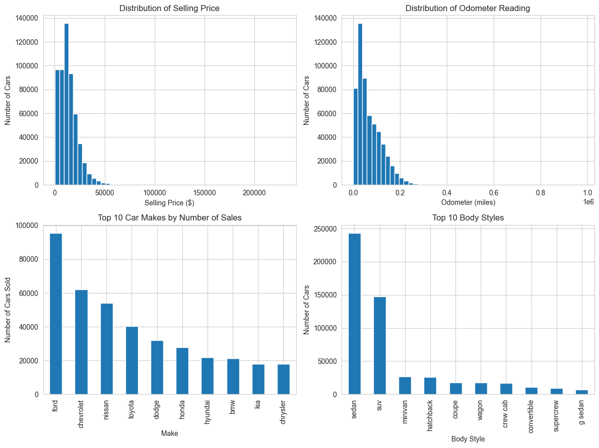
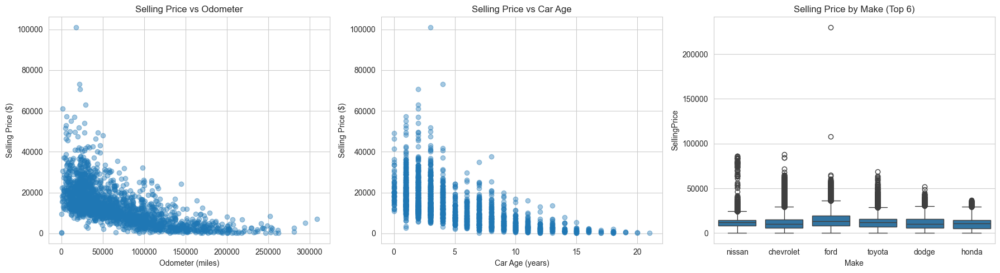
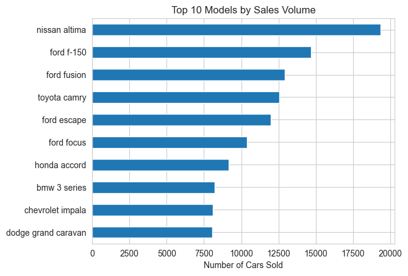

# Used Car Price Prediction - Linear Regression from Scratch

Exploratory analysis of used car auction sales, followed by a linear regression model written **from scratch in NumPy** (Batch Gradient Descent and Stochastic Gradient Descent) and compared with scikit-learn.

## Dataset

- **558,723 rows** and 28 columns after cleaning. Each row is one used car sale.
- **Target:** `SellingPrice`.
- Features used for the model: `CarAge`, `Odometer`, `ConditionValue`, `Make`, `Model`, `Body`, `Transmission`, `State`, `Color`, `Interior`, plus two squared features (`CarAge2`, `Odometer2`).
- The cleaned data is stored in `vehicle_sales_clean.zip` (the notebook reads it directly with `pd.read_csv`).

## What I did

1. **EDA and cleaning** (`EDA_CARSPRIVE.ipynb`): data quality checks, filling missing values, flagging outliers (not deleting them), feature engineering, charts, KPIs and validation. This notebook loads the raw data from a local SQL Server database, so it can only be re-run with that database. Its saved outputs can still be read on GitHub.
2. **Modeling** (`ml.ipynb`):
   - Linear regression from scratch with **Batch Gradient Descent** and **Stochastic Gradient Descent (SGD)**.
   - Compared with scikit-learn's `LinearRegression` and `SGDRegressor`.
   - Preparation: grouping rare categories into "other", one-hot encoding, centered squared features, and scaling all columns (scaler fit on the train set only).
3. **Dashboard:** `used car sales dashboard.pbix.pbix` (Power BI).

## Results (R² on the test set)

| Model | Training method | R² |
|---|---|---|
| My `linearregression` (lr=0.3, 2000 iterations) | Batch Gradient Descent | 0.7906 |
| sklearn `LinearRegression` | Closed-form solution | 0.7907 |
| My `sgd` (lr=0.001, 5 epochs) | Stochastic Gradient Descent | 0.7830 |
| sklearn `SGDRegressor` | Stochastic Gradient Descent | 0.7869 |

## Key findings

- The model and the training method are different things: all four are the same linear model, and only the way the weights are found differs.
- My Batch GD reached almost the same R² as sklearn's `LinearRegression` (0.7906 vs 0.7907).
- Scaling all columns and centering the squared features made Batch GD much closer to the optimum (R² 0.6567 before, 0.7906 after).
- Batch GD needed about 2000 iterations, while SGD needed only 5 epochs. Pure SGD in Python is slow on large data.
- Linear regression cannot capture non-linear effects and interactions. A quick tree-based model test in an earlier experiment (not shown in the notebook) reached R² 0.93.

## Sample charts





## How to run

```bash
pip install -r requirements.txt
jupyter notebook ml.ipynb
```

Run `ml.ipynb` from this folder so that `vehicle_sales_clean.zip` is found. `EDA_CARSPRIVE.ipynb` additionally needs `pyodbc` and a local SQL Server instance with the `MotoDB.VehicleSales` table.

## Requirements

- pandas
- numpy
- scikit-learn
- matplotlib
- seaborn
- jupyter
- pyodbc (only for `EDA_CARSPRIVE.ipynb`)

## Files

| File | Description |
|---|---|
| `ml.ipynb` | Linear regression from scratch vs scikit-learn |
| `EDA_CARSPRIVE.ipynb` | Data cleaning and exploratory analysis |
| `vehicle_sales_clean.zip` | Cleaned dataset (compressed CSV) |
| `used car sales dashboard.pbix.pbix` | Power BI dashboard |
| `photos/` | Chart images |
